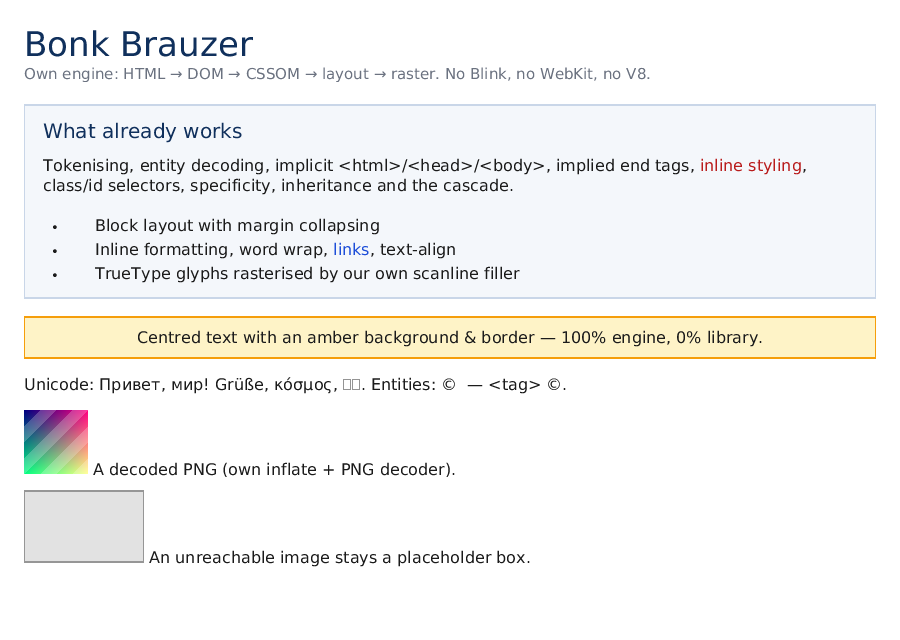

# Bonk Brauzer

Экспериментальный браузер с **собственным движком**: свой HTML-парсер, свой CSS-каскад, свой
layout, свой растеризатор и **свой JavaScript-движок**. Без Chromium/Blink, WebKit,
Gecko, Servo, V8, SpiderMonkey, QuickJS, WebView, Electron и CEF.

Зависимости: **только стандартная библиотека C++20**. Сегодня в проекте ровно ноль внешних
зависимостей — включая тест-фреймворк, inflate/PNG-кодек, парсер шрифтов, оконный backend
(протокол X11 реализован напрямую, вместо SDL2/Xlib), **TLS 1.3 с собственной криптографией**
(SHA-256, HMAC, HKDF, ChaCha20-Poly1305, X25519) и **JavaScript-движок со своим парсером
и интерпретатором**, flexbox и grid, Canvas 2D, формы с отправкой GET/POST,
cookies и `localStorage`, Same-Origin Policy с CORS и CSP, процесс на вкладку
через `fork()`+pipe, собственные devtools и прогон по внешним наборам тестов
(html5lib-tests, test262, reftests).



*Эта картинка получена командой `bonk render tests/fixtures/sample.html -o page.png`:
HTML был разобран, стилизован, разложен и растеризован целиком этим репозиторием.*

## Статус

| Этап | Содержание | Статус |
|---|---|---|
| 0 | Каркас, сборка, CI, контракты, план | **готово** |
| 1 | `net` (URL, HTTP/1.1), `html` (токенайзер + дерево), `dom` (узлы, `querySelector`) | **сделано ядро**, см. [`docs/STAGE-01-02.md`](docs/STAGE-01-02.md) |
| 2 | `css` (селекторы, каскад), `text` (TrueType), `image` (inflate + PNG), `layout` (block/inline), `paint` (растеризация + PNG) | **сделано ядро** |
| 3 | `shell`: сессия, история, скролл, клики + собственный X11-клиент (без Xlib/SDL) | **сделано ядро**, см. [`docs/STAGE-03.md`](docs/STAGE-03.md) |
| 2b | `crypto` + `net::tls` + `x509` + gzip: настоящий `https://` | **сделано ядро**, см. [`docs/STAGE-02B.md`](docs/STAGE-02B.md) |
| 4 | `js` (лексер, парсер, интерпретатор, встроенные объекты) + `bindings` (window/document/элементы/события) | **сделано ядро**, см. [`docs/STAGE-04.md`](docs/STAGE-04.md) |
| 5 | flexbox/grid, Canvas 2D, формы (GET/POST), cookies, storage | **сделано ядро**, см. [`docs/STAGE-05.md`](docs/STAGE-05.md) |
| 6 | security (SOP, CORS, CSP, mixed content), процесс на вкладку + IPC, devtools | **сделано ядро**, см. [`docs/STAGE-06.md`](docs/STAGE-06.md) |
| 7 | conformance: html5lib-tests (токенайзер + дерево), test262, пиксельные reftests | **сделано ядро**, см. [`docs/STAGE-07.md`](docs/STAGE-07.md) |

Реестр модулей — в коде (`src/core/module.cpp`), печатается бинарником и генерирует
`docs/modules.generated.md`:

```console
$ bonk modules
id        stage  status       depends on            title
---------------------------------------------------------------------
core      0      done         -                     Core utilities
net       1      in-progress  core                  Networking
html      1      in-progress  core                  HTML parser
dom       1      in-progress  core, html            DOM
text      2      in-progress  core                  Text & fonts
css       2      in-progress  dom                   CSS
layout    2      in-progress  css, dom, text        Layout
paint     2      in-progress  layout, text          Paint
...
```

## Быстрый старт

Нужен компилятор с C++20 (g++ ≥ 12 / clang ≥ 15) и GNU make. Ничего скачивать не нужно.

```console
$ make -j                 # build/bonk и build/bonk_tests
$ make test               # 333 юнит-теста
$ make conformance        # прогон по html5lib-tests/test262/reftests -> docs/conformance.md
$ make verify             # тесты + selftest + проверка актуальности docs
$ make MODE=release -j
$ make SAN=address,undefined test   # ASan + UBSan
```

Корпуса для conformance-прогона в репозитории не лежат (они большие и со своими
лицензиями). Один раз скачать:

```console
$ ./tools/fetch_conformance.sh   # html5lib-tests (tokenizer + tree), test262, reftests
```

Без корпусов `make test` и `make verify` работают как обычно: conformance-раннеры
пропускают отсутствующие наборы, а `tests/conformance/reftests/` лежат в репозитории.

CMake-путь (IDE/CI):

```console
$ cmake -S . -B build-cmake -DCMAKE_BUILD_TYPE=Release
$ cmake --build build-cmake -j && ctest --test-dir build-cmake --output-on-failure
```

### Отрисовать страницу

```console
$ bonk render tests/fixtures/sample.html -o page.png --width 900 --height 640
rendered tests/fixtures/sample.html -> page.png (900x640, nodes=70, css-rules=10,
         font=/usr/share/fonts/truetype/dejavu/DejaVuSans.ttf, doc-height=562)
```

Полезные флаги: `--font PATH` (или `BONK_FONT`), `--css extra.css`, `--debug-boxes`
(контуры всех блочных боксов), `--dump-layout` (дерево боксов с геометрией), `--diagnostics`.

### JavaScript

```console
$ bonk js 'var s = 0; for (var i = 1; i <= 10; i++) s += i; s'
55
$ bonk js script.js                      # файл или выражение — что найдётся на диске
$ bonk view docs/demo/js.html --screenshot js-demo.png --click 57,286
```

`docs/demo/js.html` целиком строится скриптом: карточки через
`document.createElement/appendChild`, счётчик кликов через `addEventListener`, классы через
`classList`. Скриншоты: [`docs/demo/js-demo.png`](docs/demo/js-demo.png) (после загрузки) и
[`docs/demo/js-demo-click.png`](docs/demo/js-demo-click.png) (после клика) — это полный цикл
JS → DOM → CSS → layout → paint.

### Остальные команды

```console
$ bonk view page.html         # открыть страницу в окне X11 (свой X11-клиент)
$ bonk view page.html --screenshot view.png --scroll 120 --click 40,60   # headless
$ bonk js 'console.log("hi", 1 + 1)'   # запуск скрипта своим JS-движком
$ bonk dom page.html          # разобранное DOM-дерево в консоль
$ bonk fetch http://host/     # HTTP/1.1 GET: статус, заголовки, размер тела
$ bonk modules --stage 2      # что входит в этап
$ bonk version --full         # версия + тулчейн
$ bonk selftest               # 23 быстрые проверки инвариантов рантайма
```

Коды возврата: `0` — успех, `1` — ошибка рендера/проверки, `2` — ошибка использования.

## Структура

```
include/bonk/          публичные заголовки по модулям
  core/                Result/Status, UTF-8, строки, арена, диагностика, реестр модулей
  crypto/              свой SHA-256/HMAC/HKDF, ChaCha20-Poly1305, X25519 (проверено на RFC)
  net/                 url, http, tls (свой TLS 1.3), x509, gzip
  html/                tokenizer, entities, html (tree builder)
  dom/                 dom, selector
  css/                 css (парсер, каскад, computed style)
  text/                font (TrueType + растеризация глифов)
  image/               image (свой inflate RFC 1951/1950 + PNG-декодер, хранилище картинок)
  layout/              layout (block/inline, box model)
  paint/               canvas (RGBA8 + PNG/PPM), render (боксы → пиксели)
  shell/               shell (сессия, история, скролл, клики), x11 (свой клиент X11-протокола)
  js/                  js (лексер, AST, tree-walking интерпретатор, встроенные объекты)
  bindings/            bindings (window, document, обёртки элементов, события, инлайновые скрипты)
  apps/                pipeline (HTML → PNG за один вызов), cli, main
src/                   реализации по модулям; src/apps/main.cpp — точка входа bonk
tests/                 свой фреймворк + 271 тест + tests/fixtures/
docs/                  ARCHITECTURE, ROADMAP, STAGE-00, STAGE-01-02, ADR, generated
.github/workflows/     CI: make×{gcc,clang}×{debug,release}, ASan/UBSan, -Werror, cmake, docs
```

Правила слоёв: `core` не зависит ни от чего; `net`/`html`/`js`/`text` зависят только от `core`;
`dom` ← `html`; `css` ← `dom`; `layout` ← `css`+`text`; `paint` ← `layout`;
`bindings` ← `js`+`dom`; UI (`shell`) — сверху.

## Документация

- [`docs/ARCHITECTURE.md`](docs/ARCHITECTURE.md) — слои, контракты, модель памяти, потоки.
- [`docs/STAGE-01-02.md`](docs/STAGE-01-02.md) — что именно работает в сети/HTML/CSS/layout/paint и чего нет.
- [`docs/STAGE-02B.md`](docs/STAGE-02B.md) — TLS 1.3 своими руками, криптоядро на векторах RFC, gzip, границы проверки сертификатов.
- [`docs/STAGE-03.md`](docs/STAGE-03.md) — оболочка: сессия, навигация, скролл, клики и свой X11-протокол.
- [`docs/STAGE-04.md`](docs/STAGE-04.md) — JS-движок и биндинги: что поддержано, что нет, как проверить.
- [`docs/STAGE-00.md`](docs/STAGE-00.md) — фундамент и инфраструктура.
- [`docs/ROADMAP.md`](docs/ROADMAP.md) — этапы 0–7 с критериями выхода.
- [`docs/modules.generated.md`](docs/modules.generated.md) — таблица модулей из кода.
- [`docs/adr/`](docs/adr/) — архитектурные решения.

## Соглашения

- Комментарии и имена в коде — английский; документация — русский.
- Ошибки: `Result<T>`/`Status`, без исключений в коде движка; ошибки разбора — в `Diagnostics`.
- Память: индексные пулы в документе + генерационные `NodeId`; никаких сырых указателей в API.
- Каждый модуль поставляется с юнит-тестами и запускаемым способом проверки результата.
