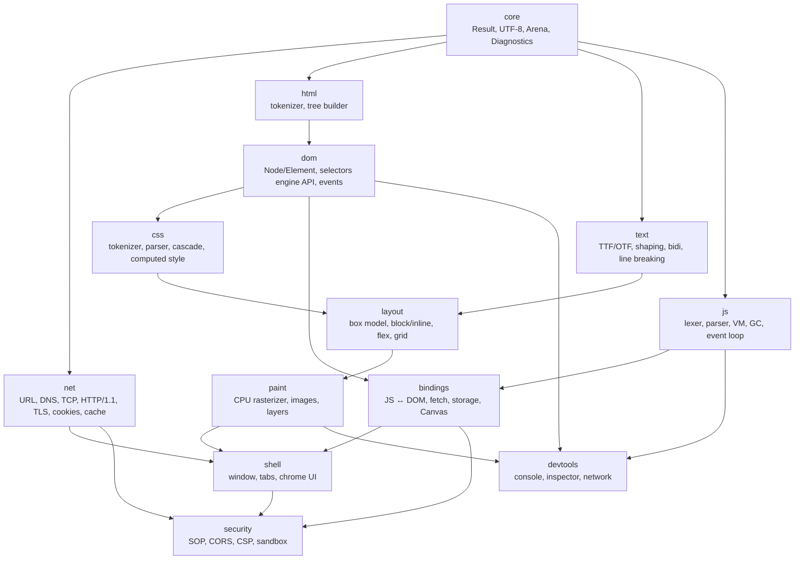

# Архитектура Bonk Brauzer

Документ фиксирует *контракты*, а не детали реализации: он должен оставаться верным, пока
движок растёт от этапа к этапу. Всё, что описано здесь как «API», на этапе 0 либо уже
реализовано (`core`), либо является обязательством для соответствующего этапа.

## 1. Слои и правила зависимостей



Жёсткие правила (проверяются на ревью, позже — скриптом в CI):

1. `core` не включает заголовков других модулей.
2. `net`, `html`, `js`, `text` зависят **только** от `core`. Сетевой код не знает про DOM,
   парсер не знает про сеть: `html` получает уже готовый буфер байтов.
3. `dom` — единственный владелец дерева документа. `css` и `layout` только читают его через
   константные интерфейсы.
4. `layout` не рисует, `paint` не считает геометрию: `paint` получает готовый список
   фрагментов (`DisplayList`), `layout` не знает про пиксели.
5. Обратных зависимостей нет. Если `net` понадобился колбэк «пришёл байт» — это стандartный
   `std::function`/интерфейс, объявленный в `net`, а не включение `dom`.

## 2. Что уже реализовано на этапе 0 (`core`)

| Компонент | Файлы | Зачем |
|---|---|---|
| `Result<T>`, `Status`, `Error` | `include/bonk/core/result.hpp`, `src/core/result.cpp` | единая модель ошибок без исключений: каждый вызов обязан посмотреть на результат |
| UTF-8 | `core/utf8.*` | весь текст движка — UTF-8; декодирование как в WHATWG Encoding (ошибка → U+FFFD, съедаем 1 байт, токенайзер всегда двигается вперёд) |
| ASCII-строки | `core/strings.*` | `trim/split/join/equals_ci/parse_u64` — база для HTML/CSS/URL-парсеров |
| Арена | `core/arena.*` | выделение памяти под DOM/computed style/layout-боксы: `reset()` вместо тысяч `free` |
| Диагностика | `core/diag.*` | HTML/CSS «терпимы к ошибкам»: парсеры не падают, а пишут в sink |
| Реестр модулей | `core/module.*` | единственный источник правды о составе и этапах; питает CLI, docs и CI |
| CLI | `cli/cli.*`, `apps/main.cpp` | разработка без GUI: `modules`, `version`, `selftest` |
| Selftest | `core/selftest.*` | быстрая проверка инвариантов у *отгруженного* бинарника |
| Тест-фреймворк | `tests/test_framework.hpp` | авторегистрация тестов, `CHECK/REQUIRE`, фильтр, без внешних зависимостей |

## 3. Модель памяти

Три времени жизни, три механизма — смешивать их нельзя:

1. **Документ** (страница + её DOM + CSSOM + layout-боксы) — `Arena`.
   Дерево умирает целиком при навигации/пересборке, поэтому бамп-аллокатор даёт выделение
   за ~5 нс и нулевую фрагментацию. В арене не может быть нетривиальных деструкторов —
   это правило, а не пожелание.
2. **Долгоживущие объекты** (кэш, история, закладки, вкладки) — обычные контейнеры STL,
   владение через `std::unique_ptr`, без ручного `new/delete` в бизнес-логике.
3. **Связи между узлами и внешним кодом** — генерационные хендлы, **не указатели**:

```cpp
struct NodeId {            // 8 байт, копируется как значение
  std::uint32_t index;
  std::uint32_t generation;
};
```

`NodeId` живёт в JS-биндингах, в devtools, в списках «выделенные элементы». Если узел удалён,
`generation` в слоте увеличивается, и старый хендл становится невалидным *проверяемо*
(`dom::Document::resolve(NodeId) -> Result<Node*>`), а не «случайно работает».

Почему не `shared_ptr` на каждый узел: 3 поля × 16 байт контроля на узел, разрушение дерева
становится рекурсивным обходом, циклы parent↔child требуют `weak_ptr` и ручной чистки.

## 4. Модель ошибок и диагностики

- **Ошибка-значение** (`Result<T>`): DNS не разрешился, TLS не сошёлся, файл не открылся.
  Вызывающий обязан обработать; молча проигнорировать нельзя — `[[nodiscard]]`.
- **Диагностика** (`Diagnostics`): неверный HTML, неизвестное CSS-свойство, ошибка в скрипте.
  Это *не* повод не отрисовать страницу. Записи читают консоль и devtools.
- Исключения в коде движка не бросаем и не ловим (кроме границы «приложение»), но и не
  выключаем `-fno-exceptions`: стандартная библиотека на них опирается.
- Коды ошибок неймспейсованы: `net.*`, `url.*`, `html.*`, `css.*`, `js.*`, `cli.*`.

## 5. Потоки и конкурентность

Этап 1–2 — однопоточный движок + отдельный сетевой поток:

```
[UI/движок]  --запрос-->  [net worker: DNS/TCP/TLS/HTTP]  --события-->  [очередь в UI]
     ^                                                                        |
     +-------------------------- раз в кадр забираем события -----------------+
```

- Сеть никогда не блокирует отрисовку: загрузка идёт стримом, парсер начинает работу с
  первых байтов (progressive parsing — так же, как в настоящих браузерах).
- Обмен только сообщениями (`std::variant`-события в очереди), общих изменяемых структур нет.
- Этап 6 добавляет процесс на вкладку: контракт сообщений остаётся тем же, меняется транспорт
  (сокет вместо очереди) — поэтому очередь проектируется сразу как «канал», а не как `global`.

## 6. Контракты модулей (что будет обещано на следующих этапах)

Сигнатуры ниже — обязательства этапа 1/2; на этапе 0 они не компилируются намеренно, чтобы в
репозитории не было мёртвых заглушек.

```cpp
// net — этап 1
struct Url { std::string scheme, host, path, query; std::optional<std::uint16_t> port; /* ... */ };
Result<Url> parse_url(std::string_view input, const std::optional<Url>& base);
struct Request { Url url; std::string method = "GET"; std::vector<std::pair<std::string,std::string>> headers; };
struct Response { int status; std::vector<std::pair<std::string,std::string>> headers; std::vector<std::uint8_t> body; };
Result<Response> fetch(const Request& request, Diagnostics& diagnostics);

// html — этап 1
// Токенайзер работает по правилам WHATWG: вход — байты, выход — поток токенов.
// Tree builder создаёт узлы через интерфейс dom::DocumentBuilder, поэтому html не зависит от dom.
struct TreeSink { /* create_element, append_child, set_attribute, ... */ };
Status parse_html(std::string_view bytes, TreeSink& sink, Diagnostics& diagnostics);

// dom — этап 1
Result<Node*> Document::resolve(NodeId id);
std::vector<Node*> Document::query_selector_all(std::string_view selector);

// layout — этап 2
struct LayoutBox;
std::unique_ptr<LayoutBox> layout_document(const dom::Document&, const css::ComputedStyleMap&, const LayoutViewport&);

// paint — этап 2
DisplayList build_display_list(const LayoutBox&);
void rasterize(const DisplayList&, paint::Canvas& target);
```

## 7. Тестовая стратегия

| Уровень | Инструмент | Что проверяет |
|---|---|---|
| Юнит-тесты | `tests/**/*.cpp`, `make test` | поведение каждого модуля, включая граничные случаи |
| Selftest | `bonk selftest` | инварианты у собранного бинарника (таблицы UTF-8, реестр модулей) |
| Санитайзеры | `make SAN=address,undefined test` | утечки, UB, выход за границы (в CI на каждый push) |
| Конформность | этап 7 | html5lib-tests, test262, WPT, Acid2 |
| Фикстуры | `tests/fixtures/` (с этапа 1) | реальные страницы, эталонные деревья/скриншоты |

Тест, который не воспроизводит найденный баг, считается незавершённым фиксом.
