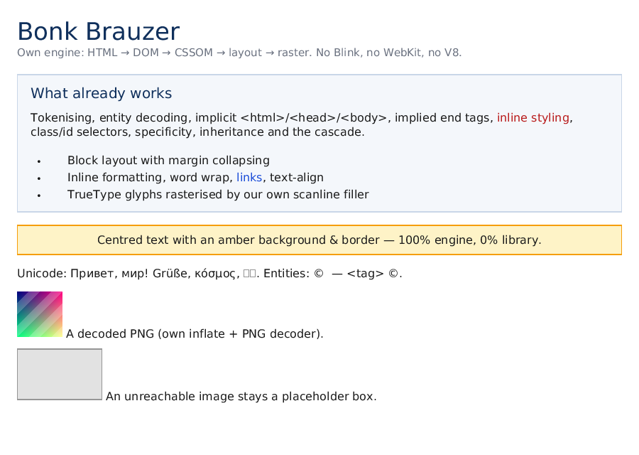

# Этапы 1–2: сеть, HTML, DOM, CSS, шрифты, layout, растеризация

Реализовано «вертикальным срезом»: вместо того чтобы сдавать этап 1 и ждать, собран полный
конвейер от байтов страницы до PNG. Ниже — что именно работает, чем это проверено и что
сознательно не сделано.

## Конвейер

```
файл/URL ──► net::Url ──► net::http_get ─────────────┐
                                                      ▼
                              html::Tokenizer (14 состояний, entities)
                                                      ▼
                         html::TreeBuilder (implicit html/head/body, implied end tags)
                                                      ▼
                     dom::Document (POD-пул узлов, NodeId с генерацией, querySelector)
                                                      ▼
                 css::StyleSheet (<style>, <link>, style="...") + UA-таблица
                                                      ▼
                css::compute_styles (каскад, специфичность, наследование, @media)
                                                      ▼
              image::decode_png (свой inflate, для каждого ) ──┐
                                                                    ▼
              layout::layout_document (блочный контекст, inline, margin collapsing)
                                                      ▼
                 paint::render_layout ──► paint::Canvas ──► PNG (свой энкодер)
```

## Что работает

### net
- **URL**: схемы http/https/ws/wss/ftp/file, userinfo, IPv4/IPv6, порты, percent-encoding,
  удаление dot-segments, разрешение относительных ссылок относительно базы (RFC 3986 §5).
  Не-ASCII хосты отклоняются с кодом `url.non_ascii_host` (IDNA — отдельная задача).
- **HTTP/1.1**: DNS (`getaddrinfo`), TCP с таймаутами (non-blocking connect + `poll`),
  разбор статуса и заголовков, `Content-Length`, `chunked`, редиректы 301/302/303/307/308
  (до 5, относительный `Location`), `Connection: close`.
- Тесты: 12 (юнит + реальный сокет-сервер на loopback в трёх сценариях).

### html
- Токенайзер: `data`, `RCDATA`, `RAWTEXT`, `PLAINTEXT`, теги, атрибуты (4 состояния значений),
  комментарии, doctype, bogus comment, `CDATA`; нормализация `\r\n`/`\r`, BOM;
  именованные (≈250) и числовые character references с U+FFFD для некорректных.
- Дерево: неявные `<html>/<head>/<body>`, «подразумеваемые» закрывающие теги (`p`, `li`,
  `dd/dt`, `option`, `tr/td/th`, `h1..h6`), void-элементы, `<title>/<style>/<script>` в head,
  диагностика `html.stray_end_tag` / `html.misnested_end_tag`.
- Тесты: 17 (включая сериализацию обратно в HTML).

### dom
- Узлы — POD-записи в пулах документа + связные списки детей; `NodeId{index, generation}`,
  поэтому удалённый узел обнаруживается (`is_alive`), а не превращается в use-after-free.
- `create_element/text/comment/doctype`, `append/insert_before/remove`, атрибуты, классы,
  `text_content`, `to_html` (с экранированием), `debug_tree`, `query_selector(_all)`,
  `get_element_by_id`, `get_elements_by_tag_name`.
- Селекторы: тип, `*`, `.class`, `#id`, `[attr]` с `= ~= |= ^= $= *=`, потомок и `>`,
  `:first-child`, `:last-child`, `:only-child`, `:root`, `:link`, `:not(...)`, списки через
  запятую, вычисленная специфичность.
- Тесты: 13.

### css
- Парсер правил с комментариями, `!important`, `@media` (`screen`/`print`/`all` +
  `min-width`/`max-width`), `@font-face` (собирается, шрифт грузит text-модуль).
- Значения: `px/pt/pc/in/cm/mm/em/rem/%/auto`, цвета `#rgb/#rrggbb/#rrggbbaa/rgb()/rgba()`
  и ~50 именованных, шорткаты `margin/padding/border/background/font`.
- Каскад: UA-таблица (написана как CSS и разобрана своим парсером) → авторские правила →
  `style="..."`; сортировка по важности → origin → специфичности → порядку; наследование
  шрифта/цвета/выравнивания; `em`/`rem` в computed values уже в пикселях.
- Тесты: 17.

### text
- Свой парсер TrueType: `head/hhea/maxp/hmtx/loca/glyf`, cmap форматов 4 и 12, простые и
  составные контуры, квадратичные кривые → полигоны, заливка scanline с non-zero winding и
  суперсэмплингом 4×4, кэш глифов. Без hinting.
- Фолбэк: встроенный «tofu» (пустой бокс), если файла шрифта нет; `BONK_FONT` или
  `--font PATH` подключают реальный шрифт, по умолчанию ищется DejaVu/Liberation.
- Тесты: 6.

### image
- **inflate** (RFC 1951) написан с нуля: stored/fixed/dynamic Huffman, проверка
  переподписки кодов, повторения 16/17/18, все дистанции; **zlib**-обёртка (RFC 1950) с
  проверкой Adler-32.
- **PNG** (RFC 2083): цветовые типы 0/2/3/4/6, битовые глубины 1/2/4/8/16 (16 → старший байт),
  все пять фильтров scanline, Adam7, PLTE, ограничение 16384×16384 и 64 МиБ на файл.
- `ImageStore` загружает `` относительно каталога страницы; ошибка декодирования —
  диагностика, а не сбой рендера (в фикстуре это видно на `missing.png`).
- Курсор: `paint` масштабирует битмап методом ближайшего соседа (ресемплинг — этап 6).
- Тесты: 8 (stored-блок, Adler-32, Sub-фильтр, палитра, grey+alpha, битые входы, хранилище).

### layout
- Блочный контекст: box model, `width/height/min-height`, `%`/`em`/`auto`, схлопывание
  вертикальных margin'ов, `display: none`, list-item с маркером.
- Inline: сбор текстовых ранов, перенос по словам, `line-height`, выравнивание
  `left/center/right`, `<b>/<i>/<a>` как отдельные раны со своим стилем, `` как атомный
  инлайн с размерами из атрибутов.
- `hit_test` для попаданий мышью (пригодится оболочке на этапе 3).
- Тесты: 12.

### paint
- Canvas RGBA8: `clear`, `fill_rect`, `stroke_rect`, `blend_pixel` (альфа-смешивание),
  `draw_glyph/draw_text` с покрытием, клиппинг границами канваса.
- PNG-энкодер: свой CRC32/Adler32/zlib-контейнер (блоки deflate `stored`), корректный
  IHDR/IDAT/IEND; плюс PPM для отладки. Декодеры изображений — следующий шаг.
- `render_layout`: фон → рамки → текст/подчёркивание → дети; `--debug-boxes` рисует контуры.
- Тесты: 8.

### CLI
```console
$ bonk render tests/fixtures/sample.html -o page.png --width 900 --height 520
rendered tests/fixtures/sample.html -> page.png (900x520, nodes=66, css-rules=10,
         font=/usr/share/fonts/truetype/dejavu/DejaVuSans.ttf, doc-height=482)
$ bonk dom tests/fixtures/sample.html        # дерево в консоль
$ bonk fetch http://127.0.0.1:8080/          # статус, заголовки, размер тела
```



*На картинке: заголовки, карточка с рамкой, центрированный текст, UTF-8 и сущности,
списки со своими маркерами, декодированный PNG (слева) и плейсхолдер недоступной картинки.*

## Чего нет (и почему это не заглушки)

| Возможность | Статус | Комментарий |
|---|---|---|
| TLS/HTTPS | нет | `fetch https://` возвращает `net.tls_not_implemented` — честная ошибка, не тихий сбой |
| gzip/deflate в ответах | нет | клиент просит `identity`; при `gzip` — явная ошибка |
| Cookies, кэш, keep-alive, HTTP/2 | нет | этапы 1b/5 |
| Foster parenting, adoption agency, `<template>` | нет | упрощённый tree builder; ошибки видны в диагностике |
| CSS `var()`, `calc()`, псевдоэлементы, `+`/`~` | нет | документированные пробелы этапа 5 |
| Flexbox/grid, float, absolute, таблицы | нет | этап 5; сейчас ведут себя как block/inline |
| JPEG/GIF/WebP, PNG с tRNS/гаммой/ICC | нет | PNG (кроме перечисленного) декодируется полностью; остальные форматы — плейсхолдер + диагностика |
| Ресемплинг картинок | нет | ближайший сосед: быстро, но «зубасто» при сильном уменьшении |
| Шейпинг (kerning, лигатуры), bidi, hinting | нет | метрики и позиционирование по одному глифу |
| JS-движок, события, оболочка, devtools | нет | этапы 4 и 6 |

## Ключевые решения этапа

1. **DOM на индексных пулах, а не на арене.** Узлы — POD-записи без деструкторов: сборка и
   уничтожение дерева — это `vector::clear()`, а генерация в `NodeId` ловит «висячие»
   ссылки. Арена остаётся для покадровых буферов (см. поправку к ADR 0003).
2. **Токенайзер съедает ровно один байт на ошибке.** Как в WHATWG: любой некорректный UTF-8
   или незакрытая сущность превращаются в U+FFFD и позиция растёт — парсер не может
   зациклиться. Именно этот инвариант поймал реальный баг (бесконечный цикл на `<`).
3. **UA-стили как CSS-текст, разбираемый своим парсером.** Если страница по умолчанию
   выглядит правильно, значит селекторы, каскад и наследование работают.
4. **Computed values: `em`/`rem` → px в каскаде, `%` остаётся символом.** Проценты зависят от
   содержащего блока, который знает только layout; всё остальное обязано быть решено заранее.
5. **Свой inflate/PNG-кодек, ноль внешних зависимостей.** Декодер написан по RFC 1951/1950 и
   RFC 2083: PNG от Python/zlib (dynamic Huffman) декодируется корректно — это и есть
   «проверка чужим энкодером».
6. **Свой PNG-энкодер с `stored`-блоками deflate.** Валидный файл без внешних зависимостей и
   без энтропийного кодера; файлы большие (≈1.8 МБ на 900×520), поэтому в репозиторий
   скриншот положен пере-упакованным zlib'ом.
