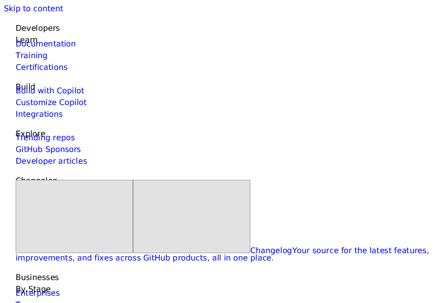

# Этап 2b: TLS 1.3, gzip и настоящий HTTPS

Задача: браузер должен открывать `https://`-страницы, не притаскивая OpenSSL. Всё сделано
с нуля: своё криптоядро, свой TLS 1.3, свой разбор X.509, свой gzip (поверх уже написанного
inflate).

```
net::TlsConnection                       bonk::crypto
  record layer  ◄──── ChaCha20-Poly1305 (RFC 8439) ──┐
  key schedule  ◄──── HKDF-SHA256 (RFC 5869/8446)    │
  key exchange  ◄──── X25519 (RFC 7748) ─────────────┘
  сертификат    ──► net::parse_certificate (X.509 DER)
  gzip/deflate  ──► image::inflate_raw + CRC-32/ISIZE
```



*Эта картинка — `bonk view https://github.com/ --screenshot github.png`: наш TLS-клиент
провёл рукопожатие с настоящим сервером, HTML был разобран, стилизован и растеризован нашим
движком. Вёрстка грубая, потому что flexbox/grid/float ещё не реализованы — но шифрование,
разбор и рендер целиком наши.*

## Криптоядро (`crypto`, 12 тестов на векторах RFC)

| Примитив | Проверен на |
|---|---|
| SHA-256 | пустая строка, «abc», 2 блока, инкрементальный режим |
| HMAC-SHA256 | RFC 4231 #1 и #2 |
| HKDF extract/expand | RFC 5869, тест-кейс 1 (PRK и OKM целиком) |
| ChaCha20 (block + stream) | RFC 8439 §2.3.2 и §2.4.2 (полные 114 байт) |
| Poly1305 | RFC 8439 §2.5.2 |
| ChaCha20-Poly1305 AEAD | RFC 8439 §2.8.2 целиком: шифротекст **и** тег |
| X25519 | RFC 7748 §5.2 (scalar mult), §6.1 (обмен ключами Алиса↔Боб) |

Реализация: 5×51-битных лимбов для поля 2²⁵⁵−19, лестница Монтгомери без ветвлений по
секрету, Poly1305 на 26-битных лимбах, AEAD с pad16 и 8-байтовыми длинами. RNG — `getrandom()`
с откатом на `/dev/urandom`.

## TLS 1.3 (`net/tls.cpp`)

* Набор шифров ровно один: `TLS_CHACHA20_POLY1305_SHA256`; обмен ключами — `x25519`.
  Если сервер не согласится, ошибка честная (`net.tls_unsupported_cipher`), а не тихий откат.
* Полный рукопожатный цикл: `ClientHello` → `ServerHello` → `ChangeCipherSpec` (для
  middlebox-совместимости) → `EncryptedExtensions` → `Certificate` → `CertificateVerify` →
  `Finished` → наш `Finished`.
* **Finished проверяется по HMAC** над хешем транскрипта — подмена рукопожатия не пройдёт
  (`peer.finished_verified`).
* Ключи: `HKDF-Extract`/`HKDF-Expand-Label` по RFC 8446 §7.1, включая `Derive-Secret` с
  контекстом `Hash("")`; отдельные ключи для рукопожатия и прикладных данных, счётчик
  sequence для nonce каждого записанного/прочитанного рекорда.
* Записи: inner content type + нулевой padding, AD = заголовок записи.

## Что проверяется в сертификате (и что нет)

Проверяется **всегда**:
* цепочка разбирается до листового сертификата, извлекаются SAN (dNSName), CN, срок действия;
* совпадение имени хоста с SAN по RFC 6125, включая wildcard `*.example.com` (ровно одна метка);
* текущее время внутри `[notBefore, notAfter]`.

**Не проверяется пока** (явно и громко):
* подпись `CertificateVerify` (RSA-PSS/ECDSA) — нужен bigint modexp и P-256 ради этого;
* подписи в цепочке и доверие к корневым CA.

Поэтому `TlsPeerInfo::chain_verified` всегда `false`, а `bonk fetch https://… --diagnostics`
печатает `net.tls: TLS 1.3 … (certificate chain NOT verified yet)`. Это осознанный компромисс
этапа 2b: шифрование и проверка свежести/имени есть, доверие к цепочке — этап 6 (нужна
таблица корневых сертификатов + подписи).

## gzip / deflate

`Content-Encoding: gzip` и `deflate` разбираются нашим inflate (тот же, что в PNG-декодере):
заголовок gzip (FEXTRA/FNAME/FCOMMENT/FHCRC), CRC-32 всего тела и ISIZE сверяются — подмена
тела обнаруживается.

## CLI

```console
$ bonk fetch https://github.com/ --diagnostics
hint: net.tls: TLS 1.3 TLS_CHACHA20_POLY1305_SHA256 x25519 (certificate chain NOT verified yet)
HTTP 200 OK
$ bonk view https://github.com/ --screenshot github.png --width 900 --height 620
viewed https://github.com/ -> github.png (900x620, title="GitHub · …", nodes=2858, scroll=0)
```

Для отладки рукопожатия: `BONK_TLS_DEBUG=1 bonk fetch https://host/` печатает наш
`ClientHello` в hex.

## Тесты (сейчас 209, все зелёные)

* `tests/crypto/crypto_test.cpp` — 12 тестов на векторах RFC (см. таблицу выше).
* `tests/net/tls_test.cpp` — 9 тестов: разбор сертификата из фикстуры, wildcard-совпадение
  имён, окно валидности (включая границы), мусор вместо DER, gzip (успех, битая магия, битый
  CRC/ISIZE), детерминизм расписания ключей и зависимость от транскрипта, round-trip защиты
  записей с sequence-номерами. Два «живых» теста (github.com и полный HTTPS-запрос через
  `http_get`) включаются переменной `BONK_TEST_NET=1` — CI остаётся офлайновым.
* Плюс обновлённые тесты HTTP/оболочки: `https` больше не «not implemented».

## Чего нет

* Проверки подписи сертификата и цепочки доверия (см. выше) — это самый важный следующий шаг
  в безопасности.
* AES-GCM (сознательно: не предлагаем AES-наборы), TLS 1.2, HTTP/2, ALPN, session resumption
  (PSK), OCSP/CRL, revocation.
* Шейпинг/поддержка клиентских сертификатов, SNI для нескольких имён в одном соединении.
* Прокси (HTTP `CONNECT`) — пригодится, когда понадобится ходить через корпоративные сети.

**Дальше по плану** — этап 4: свой JavaScript-движок (`js`) и `bindings` (события, DOM API),
чтобы страницы оживали.
