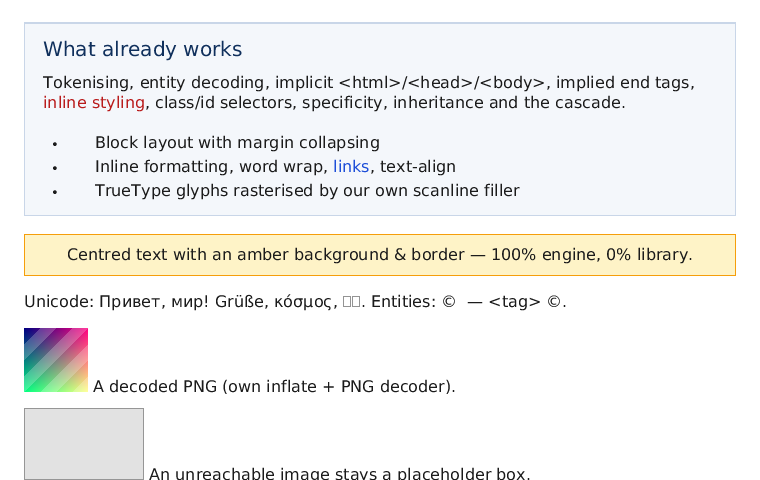

# Этап 3: оболочка браузера и собственный X11-клиент

Задача этапа — окно, ввод и управление страницей. SDL2/winit в этой среде недоступны
(нет сети для установки пакетов), поэтому окно реализовано **напрямую по протоколу X11**:
ни Xlib, ни XCB, ни SDL — только `AF_UNIX`-сокет и байты протокола. Бонусом это лучше
соответствует духу проекта («свой движок, 0 внешних зависимостей»).

## Из чего состоит этап

```
bonk view page.html
      │
      ▼
shell::Session ────────────────────────────────┐   состояние вкладки, навигация,
  │  navigate(url|path)                        │   история, скролл, клики
  │  back()/forward()/reload()                 │   (тестируется без окна)
  │  click(x, y) → hit_test → <a href>         │
  │  render(canvas) → paint::render_layout     │
  ▼                                            │
paint::Canvas (RGBA8, viewport)                │
  ▼                                            │
shell::x11::Window::present(canvas)            │   свой X11-клиент
  PutImage (ZPixmap, 32bpp, BGRX)              │   handshake, атомы, события
  ▲                                            │
  │  Expose / ConfigureNotify / ButtonPress    │
  │  MotionNotify / KeyPress / ClientMessage   │
  └────────────────────────────────────────────┘
```

## shell::Session — вся «браузерная» логика без окна

- `navigate(target)` принимает `file:`, `http:`, `https:` и обычные пути; относительные
  ссылки разрешаются через `net::parse_url(url, base)`, локальные — от каталога страницы.
- Загрузка страницы: HTML → CSS (`<style>`, локальные `<link rel=stylesheet>`) → каскад →
  layout → картинки (`` через `image::ImageStore`). Заголовок берётся из `<title>`,
  иначе из имени файла.
- История — вектор URL + индекс; `back()`/`forward()` не дублируют записи (проверяется тестом).
- `scroll_by` / `set_scroll` ограничены `max_scroll() = document_height − viewport_height`.
- `click(x, y)`: `layout::hit_test` по точке `(x, y + scroll)` → подъём по боксам к их DOM-узлам
  → первый `<a href>` → навигация. Возвращает `ClickOutcome{followed_link, href, needs_reload}`.
- `resize()` пересобирает layout (переливка строк и `%`-ширины), `reload()` перезагружает URL.
- `render_to_png()` — headless-режим: та же отрисовка, что в окне, но в файл.

## shell::x11 — протокол X11 своими руками

Реализованное подмножество (все запросы — в `src/shell/x11.cpp`, кодируются публичными
функциями `x11::proto::*`, чтобы их можно было проверять без дисплея):

| Запрос | Зачем |
|---|---|
| `Setup` | рукопожатие, выбор экрана, root-window, depth, black pixel |
| `InternAtom`, `ChangeProperty` | заголовок окна (`WM_NAME`) и `WM_PROTOCOLS` → `WM_DELETE_WINDOW` |
| `CreateWindow`, `MapWindow`, `SetInputFocus` | создание, показ и фокус ввода |
| `CreateGC`, `PutImage` (ZPixmap, 32bpp) | кадр целиком: RGBA → BGRX → окно |
| `SelectInput` | Expose, Configure, ButtonPress/Release, Motion, KeyPress |
| `GetKeyboardMapping` | keycode → keysym без Xlib (стрелки, PageUp/Down, Home/End) |

Аутентификация: `MIT-MAGIC-COOKIE-1` читается из `$XAUTHORITY` или `~/.Xauthority`
(разбор формата `.Xauthority`: family, address, number, name, data). Без cookie сервер
обычно отказывает — сообщение об отказе показывается как есть.

Ограничения backend'а: только локальный дисплей (`/tmp/.X11-unix/XN`, без TCP),
один экран/визуал (TrueColor 24 бит), без масштабирования HiDPI, без `WM_SIZE_HINTS`,
кадр отправляется целиком (нет dirty-rect'ов и MIT-SHM).

## Управление

```console
$ bonk view tests/fixtures/sample.html
```

| Ввод | Действие |
|---|---|
| колесо мыши | прокрутка ±60 px |
| ЛКМ | клик: переход по ссылке |
| ↓ / ↑ | прокрутка на 40 px |
| PageDown / PageUp | прокрутка на 90 % окна |
| Home / End | в начало / в конец |
| закрытие окна (WM) | выход |

Headless-режим (работает в CI и в этой песочнице):

```console
$ bonk view tests/fixtures/sample.html --screenshot view.png --width 700 --height 500 --scroll 120
viewed tests/fixtures/sample.html -> view.png (700x500, title="Bonk Brauzer — stage 2 smoke page",
       nodes=70, scroll=83)
```

`--scroll` ограничивается длиной документа, поэтому 120 превратились в 83 — это и есть
проверка клиппинга скролла.



## Тесты

- `tests/shell/shell_test.cpp` — 9 тестов: навигация по локальному файлу, `<title>`,
  клиппинг скролла, клик по ссылке (`display:block` якорь), клик по обычному тексту,
  back/forward, отсутствующий файл (`io.open_failed`), `https` (`net.tls_not_implemented`),
  `render_to_png` (на выходе настоящий PNG).
- `tests/shell/x11_test.cpp` — 8 тестов: раскладка `Setup`-запроса, `CreateWindow`
  (id, parent, размеры, background pixel), `PutImage` (ZPixmap, глубина 24, пиксели),
  `InternAtom`/`GetKeyboardMapping`, декодирование `Expose`, `ConfigureNotify` (800×600),
  `ButtonPress` (координаты 210,300), игнор неизвестных событий, проба `DISPLAY`.

Всего в проекте **187 тестов**, все зелёные; ASan/UBSan и release-сборка с `-Werror` чистые.

## Что работает / чего нет

**Работает**: открытие локальных страниц и `http://` в окне X11, прокрутка (колесо,
клавиши), переходы по ссылкам кликом, история, изменение размера окна с переливкой,
закрытие окна по протоколу WM, headless-скриншот из состояния сессии.

**Нет**: вкладок в UI (модель `Tab` есть, интерфейса нет), адресной строки и панелей
(рисуются на этапе 5 вместе с формами), закладок/загрузок, HiDPI, dirty-rect'ов,
`http://` со страницы (смешанный контент на этапе 6), HTTPS — следующий шаг по вашему
выбору: **сначала TLS/HTTPS, потом JS**.

**Следующий шаг** (по вашему решению): этап 2b — TLS 1.3 + gzip, чтобы `https://`-сайты
действительно открывались; затем `js` + `bindings` (этап 4).
