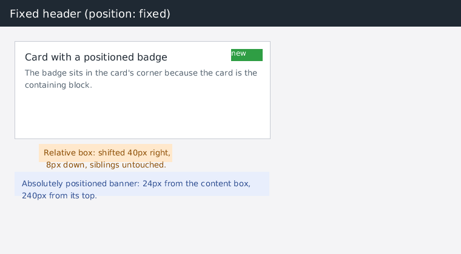

# Этап 20: позиционирование — `position`, вставки, `z-index`

После этапа 5 в раскладке был один пробел, который ломал почти любую реальную
вёрстку: `position` не поддерживался вообще. Свойство молча игнорировалось, и
`position: absolute` превращался в обычный блок в потоке — то есть «прибитый к
углу» бейдж растягивал страницу, фиксированная шапка уезжала при скролле, а
центрирование через `left/top` не работало. Этот этап закрывает позиционирование
целиком: `static | relative | absolute | fixed`, вставки `top/right/bottom/left`,
`z-index`, разрешение содержащего блока и второй проход раскладки.

*`bonk render tests/fixtures/positioning.html` (760×420): фиксированная шапка,
карточка с абсолютным бейджем в правом верхнем углу, относительно сдвинутый блок
и абсолютный баннер, привязанный к содержащему блоку `.content`.*

## Результат в цифрах

| набор | этап 19 | этап 20 | Δ |
|---|---|---|---|
| собственные юнит-тесты | 409 | **424** | +15 |
| пиксельные reftests | 7 / 7 | **9 / 9** | +2 |
| html5lib tree-construction | 1 792 / 1 792 | 1 792 / 1 792 | без изменений |
| html5lib tokenizer | 6 792 / 6 820 | 6 792 / 6 820 | без изменений |
| test262 | 2 673 / 13 254 | 2 673 / 13 254 | не трогали |

Два новых reftest'а — `position-absolute` и `position-fixed`: страница,
свёрстанная через `position`, обязана совпасть пиксель в пиксель со страницей,
свёрстанной потоком/flex. Попутно выяснилось, что старый reftest `nested-blocks`
раньше проходил **случайно**: его эталон (`-ref.html`) использует
`position:absolute`, который до этого этапа просто игнорировался, — то есть
эталон и проверяемая страница совпадали «потому что обе были сломаны одинаково».
Теперь он проходит по-настоящему.

## Что сделано

### 1. CSS: свойства и вычисленные значения

`ComputedStyle` получил `position`, `inset[4]` (top/right/bottom/left) и
`z-index` + `has_z_index`. Вставки инициализируются в `auto` — «не задано» должно
отличаться от явного `0`, иначе `left: 0` не отличить от отсутствия `left`.

Неизвестное значение `position` (например `sticky`) **не сбрасывает** прежнее:
правило `position: sticky` не должно превращать уже позиционированный элемент в
статический. `z-index: auto` наоборот сбрасывает число.

### 2. Второй проход раскладки

Раскладка была однопроходной: блоки укладывались сверху вниз. Вставкам нужны
окончательные координаты содержащего блока, а `bottom` — ещё и собственная высота
бокса, которая известна только после раскладки содержимого. Поэтому:

1. **Первый проход** — обычный поток. Внепоточные дети пропускаются во *всех*
   местах, где раньше строился поток: блочные дети, инлайн-раны, элементы
   flex-контейнера, ячейки grid/table, а также `intrinsic_width` и
   `has_block_children`. Для блочных детей запоминается «статическая позиция» —
   где бокс оказался бы, останься он в потоке (используется, когда не задана ни
   одна вставка по оси).
2. **Относительные сдвиги**: `position: relative` сдвигает бокс с поддеревом по
   `top`/`left` (или от противолежащих `right`/`bottom`), соседи не двигаются.
3. **Размещение абсолютных**: обход дерева от корня ищет содержащий блок для
   каждого внепоточного бокса — ближайший позиционированный предок, а если его
   нет, начальный содержащий блок (вьюпорт). `fixed` всегда привязан к вьюпорту.
4. Документ подрастает по нижней границе абсолютных боксов (но не `fixed`), чтобы
   до них можно было доскроллить.

### 3. Ширина и высота абсолютного бокса

* `width` задан — берётся как есть;
* заданы **обе** горизонтальные вставки — бокс растягивается на остаток:
  `width = cb − left − right − margins − padding − border`;
* иначе — shrink-to-fit: ширина по содержимому (`intrinsic_width`), но не больше
  доступного места от использованной вставки до дальнего края содержащего блока;
* `min-width` / `max-width` применяются в конце.

Вертикаль: содержимое раскладывается при `y = 0`, затем бокс целиком
транслируется в нужное место — так `bottom: 0` работает с высотой по
содержимому, а не только с явной `height`.

### 4. Отрисовка и hit-testing

Появился `Box::positioned` — отдельный список внепоточных детей. Живопись рисует
сначала поток, затем `positioned`, отсортированные по `z-index` (стабильная
сортировка: при равных `z-index` порядок документальный). `fixed`-поддерево
рисуется с нулевым скроллом, поэтому шапка остаётся на месте при прокрутке.

`hit_test()` проверяет `positioned` **первыми** и в обратном порядке живописи —
клик попадает в то, что сверху. Он получил необязательный параметр `scroll_y`:
`fixed`-боксы живут в координатах вьюпорта, и точка клика для них пересчитывается
(`y − scroll_y`). Шелл передаёт скролл, поэтому фиксированная шапка остаётся
кликабельной после прокрутки.

## Проверки

* `-Werror` сборка — 0 предупреждений, ASan+UBSan — чисто;
* `make verify` — OK, `docs/conformance.md` перегенерирован;
* 15 новых юнит-тестов (12 на раскладку, 3 на CSS): вставки внутри относительно позиционированного родителя
  (с padding и border), уход из потока, растяжение между `left` и `right`,
  shrink-to-fit, `fixed` по краям вьюпорта, относительный сдвиг без влияния на
  соседей, отрицательные вставки, выбор содержащего блока (ближайший
  позиционированный предок против вьюпорта), `z-index`, hit-test,
  абсолютный бокс внутри inline-block;
* 3 теста CSS: разбор `position`/вставок/`z-index`, «неизвестное значение не
  сбрасывает прежнее», `z-index: auto`;
* 2 пиксельных reftest'а: `position-absolute` (три абсолютных бокса против
  flex-эквивалента) и `position-fixed` (фиксированная плашка против потоковой);
* ручная проверка скролла: при `--scroll 300` фиксированная шапка остаётся в
  строках 0–40, а абсолютный маркер (`top: 500px`) оказывается в строке 200.

## Что осталось

| пробел | почему важен |
|---|---|
| `float: left/right` | обтекание текстом — самая частая докомпоновка «позапрошлого» веба |
| `position: sticky` | нужен скролл-зависимый layout (липкие заголовки таблиц/секций) |
| `overflow: hidden/auto/scroll` | без обрезки абсолютные боксы вылезают за карточки, а скролл внутри блока не сделать |
| stacking contexts | сейчас порядок упрощён: позиционированные дети выше потока родителя; полноценные контексты (`opacity`, `transform`, `isolation`) — отдельная работа |
| рендеринг SVG/MathML | разбор на 100 %, но рисуются как обычные боксы |
| JS: `RegExp`, `Date`, `Promise`, `setTimeout` | 20.2 % test262 — самое слабое место движка |
