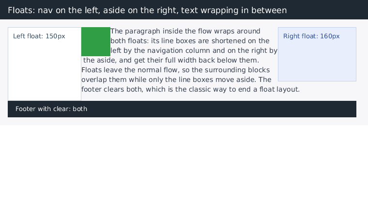

# Этап 21: floats и `clear`

После этапа 20 в раскладке остался пробел, который важнее любого другого для
реальных сайтов: `float`. Без него не собирается ни одна «классическая» вёрстка —
колонки, обтекание картинки текстом, бейджи слева от абзаца, — а `clear: both`
был единственным способом закончить такую колонку. Свойство игнорировалось
полностью: `float: left` вёл себя как обычный блок, текст не обтекал, колонки
вставали друг под другом.

*`bonk render tests/fixtures/floats.html` (760×460): навигация плавает слева,
панель — справа, текст обтекает обе колонки и получает полную ширину под ними,
бейдж обтекается первой строкой, футер с `clear: both` закрывает раскладку.*

## Результат в цифрах

| набор | этап 20 | этап 21 | Δ |
|---|---|---|---|
| собственные юнит-тесты | 424 | **434** | +10 |
| пиксельные reftests | 9 / 9 | **11 / 11** | +2 |
| html5lib tree-construction | 1 792 / 1 792 | 1 792 / 1 792 | без изменений |
| html5lib tokenizer | 6 792 / 6 820 | 6 792 / 6 820 | без изменений |
| test262 | 2 673 / 13 254 | 2 673 / 13 254 | не трогали |

## Что сделано

### 1. CSS: `float` и `clear`

`ComputedStyle` получил `float_side` (`None | Left | Right`) и `clear`
(`None | Left | Right | Both`). Логические ключевые слова `inline-start` /
`inline-end` сворачиваются в `left` / `right`: в горизонтальной записи это одно и
то же, и игнорировать их было бы странно.

### 2. Флоат выходит из потока, но не из раскладки

`place_float()`:
* ширина — shrink-to-fit: по содержимому, но не шире свободного места на текущей
  «строке»;
* если флоат не влезает в оставшееся место, он спускается ниже самого низкого из
  пересекающихся флоатов и пробует снова (до восьми попыток, как и браузерные
  движки — этот цикл конечен);
* `float: right` прижимается к правому краю той же свободной полосы;
* содержимое флоата раскладывается в **своём** formatting context: внешние флоаты
  до него не достают (`FloatGuard` подменяет список).

Сам поток от флоата **не сдвигается** — именно поэтому следующий блок наезжает на
флоат своей рамкой, а сдвигаются только строки текста.

### 3. Строки обтекают

`layout_inline_items()` перед сборкой каждой строки спрашивает `span_at()`:
какие флоаты пересекают вертикальный диапазон строки и насколько они поджимают
слева/справа. Дальше по этому же спану считается и перенос слов, и
`text-align`. Если флоаты заняли строку целиком, строка уезжает ниже
(`next_float_bottom`). Высота строки для проверки пересечения берётся как самый
высокий элемент рана — этого достаточно для текста и картинок.

### 4. `clear` и высота

`clearance()` поднимает блок (или следующий флоат) ниже флоатов нужной стороны.
Флоаты не увеличивают высоту своего родителя — это поведение `overflow: visible`
по стандарту, и именно поэтому исторически существовал clearfix. Но документ до
нижней границы флоатов доскроллить можно: корневой блок их содержит.

### 5. Флоат внутри инлайн-контекста

`
текст…
` — самая частая форма обтекания. Здесь
флоат лежит не среди блочных детей, а внутри инлайн-рана, поэтому ран сам
размещает его: в наборе инлайн-элементов флоат — это маркер (нулевой ширины),
который `layout_inline_items()` превращает в `place_float()` на текущей строке
(до расчёта спана, если флоат стоит в начале строки). Для ``/`<canvas>`
размер берётся из атрибутов/битмапа, а не из измерения содержимого — у
замещаемого элемента его нет.

### 6. Границы formatting context

Новый `FloatGuard` (RAII) очищает список флоатов и восстанавливает его на выходе.
Применяется там, где по стандарту начинается новый block formatting context:
inline-block, абсолютно позиционированный бокс и содержимое самого флоата.

## Проверки

* `-Werror` сборка — 0 предупреждений; ASan+UBSan — чисто; `make verify` — OK;
* 10 новых юнит-тестов: обтекание текстом (первая строка сдвинута, ниже флоата —
  нет), `float: right` у правого края, два флоата на одной строке и перенос
  третьего вниз, `clear` толкает блок вниз, shrink-to-fit, флоат растит документ,
  но не родителя, абсолютный бокс игнорирует флоаты, плавающая картинка внутри
  абзаца (`` — размер из атрибутов, текст справа);
* 2 теста CSS: разбор `float`/`clear`, логические ключевые слова;
* 2 пиксельных reftest'а: `float-columns` (три колонки + очищенный футер против
  flex-эквивалента) и `float-text-wrap` (текст справа от флоата против
  двухколоночного flex — доказывает, что строки поджаты ровно на ширину флоата);
* ручная проверка через `--dump-layout`: третий из трёх 150-пиксельных флоатов в
  400-пиксельном контейнере уезжает на вторую строку, правый флоат остаётся на
  первой.

## Что осталось

| пробел | почему важен |
|---|---|
| `overflow: hidden/auto/scroll` | без обрезки содержимое вылезает за карточки; `overflow` ещё и создаёт BFC (закрывает флоаты без clearfix) |
| `position: sticky` | липкие заголовки; нужен scroll-зависимый layout |
| stacking contexts | порядок живописи пока упрощён |
| флоат в середине строки | он размещается, но текущая строка не перезапускается: поджимается только следующая (в браузере строка переехала бы целиком) |
| рендеринг SVG/MathML | разбор 100 %, отрисовки нет |
| JS: `RegExp`, `Date`, `Promise`, `setTimeout` | 20.2 % test262 — самое слабое место движка |
