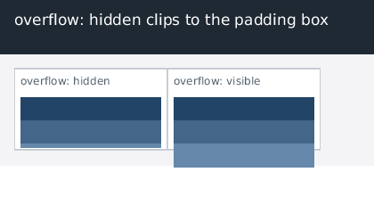

# Этап 22: `overflow` — обрезка и блок-форматирующий контекст

После этапа 21 в раскладке осталась дыра, которая видна на любой карточке с
фиксированной высотой: `overflow` не поддерживался. Содержимое вылезало за
границы своего блока (свои же строки, картинки, флоаты), а единственным способом
«закрыть» флоаты был `clear` — потому что BFC-корня не существовало. Этот этап
закрывает оба следствия одного свойства: обрезку по padding box и появление
блок-форматирующего контекста.

*`bonk render tests/fixtures/overflow.html` (420×230): слева окно с
`overflow: hidden` — третья полоса обрезана по padding box; справа то же окно с
`overflow: visible` — третья полоса выходит и за окно, и за карточку.*

## Результат в цифрах

| набор | этап 21 | этап 22 | Δ |
|---|---|---|---|
| собственные юнит-тесты | 434 | **442** | +8 |
| пиксельные reftests | 11 / 11 | **13 / 13** | +2 |
| html5lib tree-construction | 1 792 / 1 792 | 1 792 / 1 792 | без изменений |
| html5lib tokenizer | 6 792 / 6 820 | 6 792 / 6 820 | без изменений |
| test262 | 2 673 / 13 254 | 2 673 / 13 254 | не трогали |

## Что сделано

### 1. CSS: сокращение, длинные свойства и правило про `visible`

`Overflow { Visible, Hidden, Auto, Scroll }`, два поля (`overflow_x`,
`overflow_y`), разбор `overflow` (одно или два значения), `overflow-x`,
`overflow-y`. Ключевое слово `clip` ведёт себя как `hidden` (разница — в
запрете прокрутки, а прокрутки внутри блока у нас пока нет).

Отдельно реализовано правило стандарта: если одна ось клипует, а другая осталась
`visible`, то `visible` **вычисляется в `auto`**. Именно поэтому
`overflow-x: hidden` обрезает содержимое и по вертикали — так же, как в браузере.

### 2. Обрезка: clip-прямоугольник в раскладке, clip в канве

* `Box::has_clip` + `Box::clip` — padding box бокса, вычисляется после того, как
  высота окончательна (до этого padding box неизвестен).
* В канве появился clip: `set_clip()` / `reset_clip()` / `clip()`. Все операции
  рисования идут через `blend_pixel()`, поэтому одного ограничения там достаточно
  для прямоугольников, текста, подчёркиваний и картинок.
* `paint_children()` ставит clip **перед** обходом детей и снимает после, пересекая
  его с уже действующим (вложенные клипы вкладываются корректно). Собственный фон
  и рамка бокса рисуются до установки клипа: `overflow` обрезает содержимое, а не
  сам бокс.

### 3. BFC: флоаты больше не убегают

Бокс с `overflow != visible` — блок-форматирующий контекст:

* внешние флоаты до его содержимого не достают (`FloatGuard`);
* его авто-высота учитывает **собственные** флоаты. Это второй способ «закрыть»
  флоаты после `clear: both`, и именно его используют почти все современные
  вёрстки (`overflow: hidden` вместо clearfix).

### 4. Hit-testing

Точка вне clip-прямоугольника не попадает в обрезанное содержимое: `hit_test()`
возвращает `nullptr` для поддерева, которое не видно. Клик по видимой части
по-прежнему находит самый глубокий элемент.

## Проверки

* `-Werror` сборка — 0 предупреждений; ASan+UBSan — чисто; `make verify` — OK;
* 8 новых юнит-тестов: clip совпадает с padding box (padding внутри, border
  снаружи), `overflow: visible` не клипует, BFC растит высоту под флоат (и сдвигает
  следующий блок ровно на неё), одна ось клипует обе, hit-test не находит
  обрезанное содержимое;
* 3 теста CSS: сокращение и длинные свойства, правило `visible → auto`, `clip`
  как `hidden`, неизвестное значение не сбрасывает прежнее;
* 2 пиксельных reftest'а: `overflow-hidden` (большой ребёнок в маленьком окне
  против эквивалента без обрезки) и `overflow-contains-floats` (BFC-корень с
  флоатом против страницы с обычным блоком той же высоты);
* ручная проверка: в демо слева третья полоса обрезана, справа — выходит наружу;
  `--dump-layout` подтверждает `height: 40` у BFC-корня с 40-пиксельным флоатом.

## Что осталось

| пробел | почему важен |
|---|---|
| прокрутка внутри блока (`overflow: auto/scroll`) | сейчас такие боксы обрезают, но не скроллятся; нужен вложенный scroll-контейнер и передача колеса/hit-test внутрь |
| `position: sticky` | липкие заголовки; тоже scroll-зависимая раскладка |
| stacking contexts | порядок живописи пока упрощён (`z-index` среди позиционированных детей) |
| рендеринг SVG/MathML | разбор 100 %, отрисовки нет |
| JS: `RegExp`, `Date`, `Promise`, `setTimeout` | 20.2 % test262 — теперь это самое слабое место движка |
